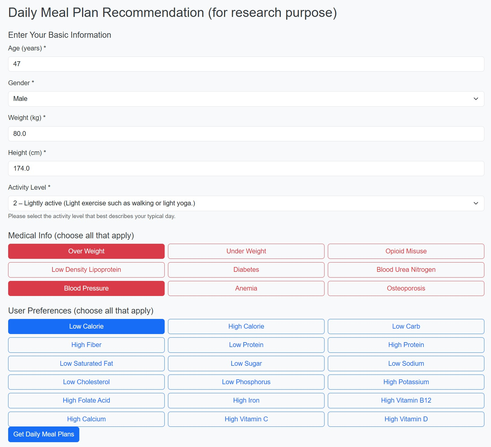
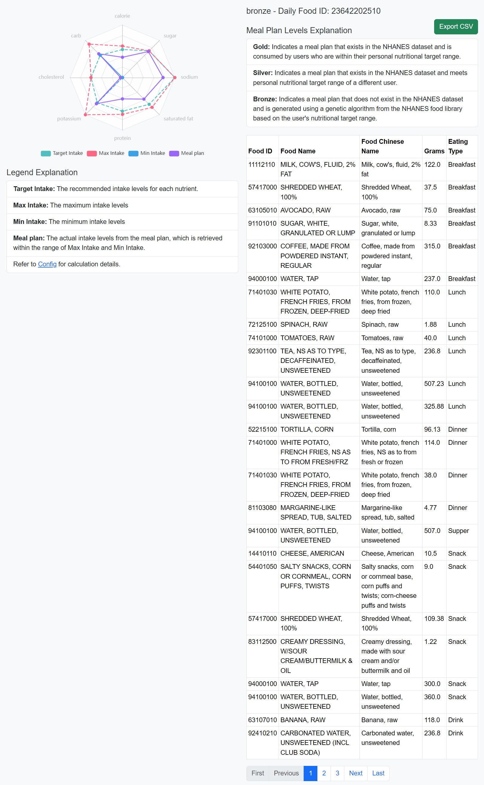

# DMP4P — Legacy integration branch

Branch: `v2`. This branch is retained for existing references and development history; its name does not define a separate method release. For current V2-Quality development use **V2.1**, now the default branch; for historical Bronze use **V2.0**. V1 is the former main code line. Do not assume this branch tracks either version automatically.

## Versions and branches

- [V1](https://github.com/tyrone1979/DMP4P/tree/V1): the earlier DMP4P generation. Its published data are at [Figshare](https://doi.org/10.6084/m9.figshare.30153778).
- [V2.0](https://github.com/tyrone1979/DMP4P/tree/V2.0): the historical structure-guided Bronze production generation.
- [V2.1](https://github.com/tyrone1979/DMP4P/tree/V2.1): V2-Quality, the current default branch.

Branch names are case-sensitive. Figshare repository release `v7` is a revision of the **V1 deposit**, not algorithm V7. Neither V2.0 nor V2.1 should cite that DOI as its generated output.

## Interpretation and limitations

Outputs are computational fixed-portion food combinations, not observed participant diets or clinically validated prescriptions. Nutrient feasibility refers only to the active supplied bounds. Meal/category priors describe empirical structure; conformity is not proof of culinary coherence, dietary adequacy or user acceptance. Exact `food_id` exclusion does not guarantee semantically different dishes. Source data, learned priors, generated artifacts and code versions must be recorded separately.

## Retained historical notes

The following notes may describe older entry points. Verify them against the files in this branch; prefer the version-specific README for new usage.

# DMP4P - Daily Meal Plan Recommendation for Personal nutrition requirement

[Online example](https://rec.neusoft.edu.cn/)

Get data at https://doi.org/10.6084/m9.figshare.30153778

1. [Data generation guidance](DATA.md)
2. [Installation](INSTALL.md)
3. [Code guidance](CODE.md)

# Usage Note
1. Input user information

2. Calculate nutrition requirement range based on user information. 
3. Search nutrition requirement range in targets table, and get target list
4. Search target list in meal_plan table and get daily_food_id list
5. Search daily_food_id list in food_user table and get food_id, eating type, grams
6. Search food_id in food_code table and get food description.
7. Return meal plans with food item list

- Author: Lei Zhao
- ORCID: 0009-0004-1363-2258
- mailto: zhaolei@neusoft.edu.cn, tyrone197913@hotmail.com
